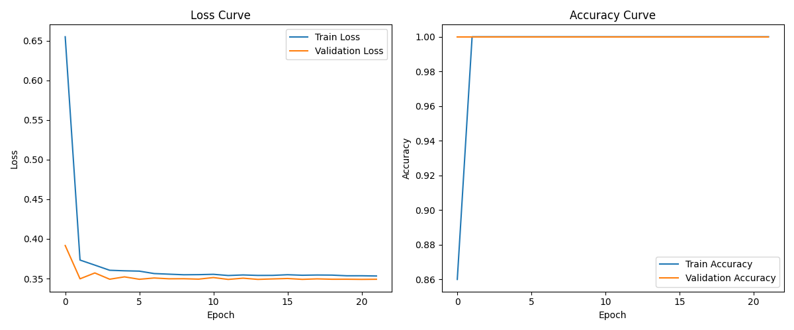
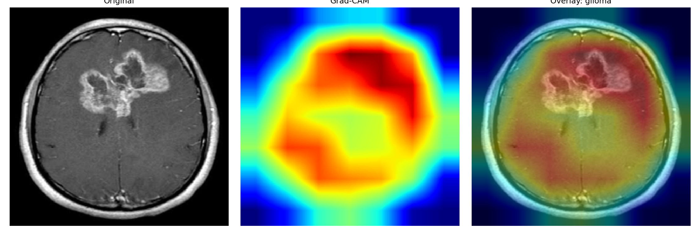
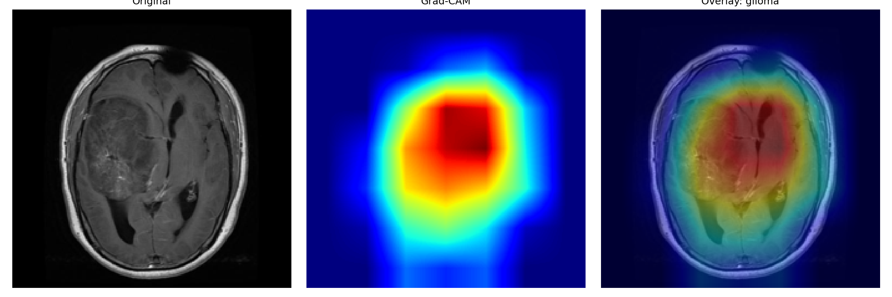
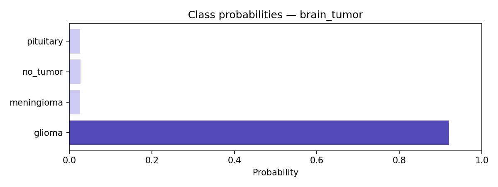
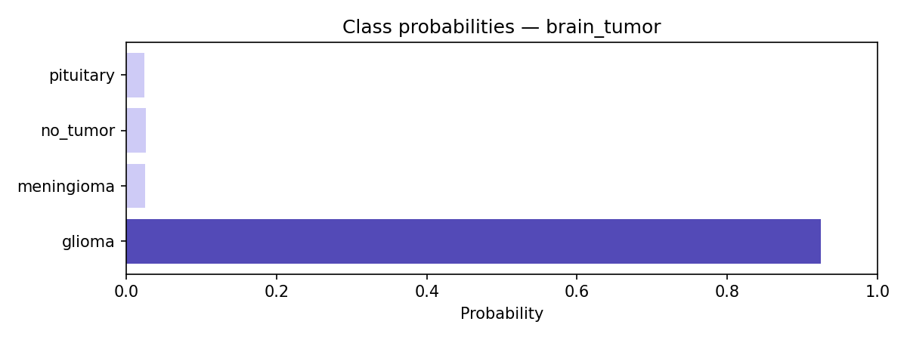

# Hybrid AI-Based Medical Image Classification System

A deep learning project that explores brain tumor classification from MRI images using a hybrid CNN–Vision Transformer architecture, with attention-based feature fusion and Grad-CAM visualization.

## Overview

Medical image classification is an important application of deep learning in healthcare. This project explores how different neural network architectures can be combined to classify brain MRI images into tumor categories.

The system combines **EfficientNet-B0** and **Vision Transformer (ViT-Tiny)** to extract complementary image features. These features are integrated through an attention-based fusion block and passed to a classification head for prediction.

In addition to classification, the project includes Grad-CAM visualizations, prediction probability plots, and a rule-based clinical guidance module.

## Key Features

- **Brain Tumor Classification:** Classifies MRI images into four categories.
- **Hybrid CNN–Transformer Architecture:** Combines EfficientNet-B0 and ViT-Tiny.
- **Attention-Based Feature Fusion:** Uses multi-head attention to combine CNN and Transformer feature representations.
- **Prediction Probabilities:** Generates probability scores for each classification category.
- **Grad-CAM Explainability:** Generates heatmaps highlighting image regions that contribute to the model's predictions.
- **Clinical Guidance:** Maps classification outputs to predefined recommendations and specialist information.

## Classification Categories

The current brain tumor classification configuration supports four classes:

| Class | Description |
|---|---|
| Glioma | Glioma tumor category |
| Meningioma | Meningioma tumor category |
| No Tumor | No tumor detected by the classifier |
| Pituitary | Pituitary tumor category |

## Model Architecture

The proposed model consists of three main components.

### 1. EfficientNet-B0 (CNN)

EfficientNet-B0 is used as the convolutional feature extractor.

It extracts spatial and local visual features from MRI images, including patterns, textures, and structural information.

The pretrained model uses global average pooling to generate a feature representation.

### 2. Vision Transformer (ViT-Tiny)

A pretrained ViT-Tiny model is used to capture global image representations.

The image is divided into patches, and the Transformer uses self-attention to learn relationships between them.

The Vision Transformer parameters are frozen in the current implementation.

### 3. Attention-Based Feature Fusion

The feature representations from EfficientNet-B0 and ViT-Tiny are projected into a common hidden dimension.

A multi-head attention mechanism combines the projected representations.

The fusion block also includes:
- Residual connections
- Layer normalization
- Feed-forward network
- GELU activation
- Dropout

The resulting fused representation is passed through a classification head to produce the final class predictions.

## System Workflow

1. Input brain MRI image.
2. Image resizing and normalization.
3. Feature extraction using EfficientNet-B0.
4. Global feature extraction using ViT-Tiny.
5. Attention-based feature fusion.
6. Classification through the final neural network layer.
7. Prediction probability generation.
8. Grad-CAM visualization.
9. Rule-based clinical guidance generation.

## Explainability – Grad-CAM

Grad-CAM (Gradient-weighted Class Activation Mapping) is implemented to visualize the image regions associated with a model prediction.

The system generates:
- Original MRI image
- Grad-CAM heatmap
- Heatmap overlay on the original image
- Class probability visualization

These visualizations help inspect the model's behavior. They do not establish that a highlighted region is medically significant.

## Technology Stack

| Category | Technologies |
|---|---|
| Programming Language | Python 3.11 |
| Deep Learning | PyTorch |
| Model Architectures | EfficientNet, Vision Transformer |
| Model Library | TIMM |
| Image Processing | OpenCV, Pillow |
| Numerical Computing | NumPy |
| Visualization | Matplotlib |
| Evaluation | Scikit-learn |

## Project Structure

```text
medicaldiagnosis/
│
├── results/
│   ├── Te-gl_1_gradcam.png
│   ├── Te-gl_1_probs.png
│   ├── Te-gl_22_gradcam.png
│   └── Te-gl_22_probs.png
│
├── clinical_guidance.py
├── config.py
├── dataset.py
├── download_datasets.py
├── gradcam.py
├── inference.py
├── main.py
├── model.py
├── train.py
├── utils.py
├── training_graphs.png
├── .gitignore
└── README.md
```

### Important directories not included in GitHub

The following directories are generated or supplied locally and are excluded from the repository:

- `data/` – Dataset images.
- `checkpoints/` – Trained model checkpoints.

## Installation and Setup

### 1. Clone the repository

```bash
git clone https://github.com/RiyaBlossoms/medicaldiagnosis.git
```

### 2. Navigate to the project directory

```bash
cd medicaldiagnosis
```

### 3. Create a virtual environment

```bash
python -m venv venv
```

Activate it on Windows:

```bash
venv\Scripts\activate
```

### 4. Install dependencies

```bash
pip install torch torchvision timm numpy matplotlib scikit-learn opencv-python pillow
```

For the optional Kaggle dataset download utility:

```bash
pip install kagglehub
```

## Dataset Preparation

The brain tumor classification pipeline expects the dataset to follow the PyTorch ImageFolder directory structure.

Organize the dataset as follows:

```text
data/
└── brain_tumor/
    │
    ├── train/
    │   ├── glioma/
    │   ├── meningioma/
    │   ├── no_tumor/
    │   └── pituitary/
    │
    ├── val/
    │   ├── glioma/
    │   ├── meningioma/
    │   ├── no_tumor/
    │   └── pituitary/
    │
    └── test/
        ├── glioma/
        ├── meningioma/
        ├── no_tumor/
        └── pituitary/
```

Each class directory should contain its corresponding MRI images.

**Note:** The dataset is not included in this GitHub repository. Obtain a compatible brain MRI dataset separately and arrange it using the directory structure above.

The `download_datasets.py` utility currently downloads retinal disease and chest X-ray datasets; it does not download the brain tumor dataset used by the current default configuration.

## Image Preprocessing

The dataset pipeline applies the following transformations:

- Resizing images to 224 × 224 pixels.
- Converting images into tensors.
- Normalizing using ImageNet mean and standard deviation.
- Random horizontal flipping during training.

## Training Configuration

The current configuration includes:

| Parameter | Value |
|---|---|
| Image Size | 224 × 224 |
| Batch Size | 20 |
| Optimizer | AdamW |
| Learning Rate | 0.0001 |
| Weight Decay | 0.00001 |
| Loss Function | Cross Entropy with Label Smoothing |
| Scheduler | Cosine Annealing |
| Dropout | 0.3 |
| Maximum Epochs | 50 |
| Early Stopping Patience | 10 |
| Random Seed | 42 |

### Dataset Subset Used

The current implementation uses a lightweight subset for demonstration:

| Split | Maximum Images |
|---|---:|
| Training | 200 |
| Validation | 50 |
| Testing | 50 |

These are maximum subset sizes; the actual counts depend on the available dataset.

The subset selection is implemented in `dataset.py`. This is a lightweight experimental setup and should not be interpreted as full-dataset evaluation.

## Running the Project

### 1. Train the model

After preparing the dataset, execute:

```bash
python main.py --mode train --disease brain_tumor
```

The training pipeline:
- Loads the dataset.
- Initializes the hybrid model.
- Trains the classification head and fusion components.
- Evaluates validation performance.
- Saves the best model checkpoint.
- Generates training and validation loss and accuracy graphs.
- Evaluates the selected checkpoint on the test subset.

The best checkpoint is saved under:

```text
checkpoints/brain_tumor_best.pt
```

### 2. Run inference

To classify an individual MRI image:

```bash
python main.py --mode infer --disease brain_tumor --image path/to/image.jpg --checkpoint checkpoints/brain_tumor_best.pt
```

Replace the image and checkpoint paths with the actual locations on your computer.

The inference pipeline generates:
- Predicted class.
- Prediction confidence.
- Predefined clinical guidance.
- Grad-CAM heatmap and overlay.
- Class probability visualization.

Generated outputs are saved in the `results/` directory.

## Training Visualization

The training script generates loss and accuracy curves to help monitor model performance during training.



## Sample Results

The repository contains sample Grad-CAM and prediction probability visualizations.

### Grad-CAM Results





### Prediction Probability Results





## Current Limitations

- The current training pipeline uses a small dataset subset for demonstration.
- The dataset and trained checkpoints are not included in the repository.
- The model has not been established as clinically validated.
- Grad-CAM provides visual explanations but does not guarantee the correctness of a prediction.
- The clinical guidance module uses predefined rules and recommendations, not a validated clinical decision-support system.

## Future Improvements

- Train and evaluate using the complete dataset.
- Perform more extensive hyperparameter tuning.
- Improve model generalization across different MRI datasets.
- Add detailed evaluation metrics and confusion matrix visualizations.
- Develop an interactive interface for image upload and prediction.
- Further investigate model explainability techniques.

## Disclaimer

This project is developed for educational and research purposes only.

The model's predictions, confidence scores, Grad-CAM visualizations, and predefined clinical guidance are not intended for medical diagnosis or treatment decisions.

The system is not clinically validated and must not replace professional medical evaluation or advice from qualified healthcare professionals.

## Author

**Riya Blossoms**

GitHub: [RiyaBlossoms](https://github.com/RiyaBlossoms)

Project Repository: [Hybrid AI Medical Diagnosis System](https://github.com/RiyaBlossoms/medicaldiagnosis)
